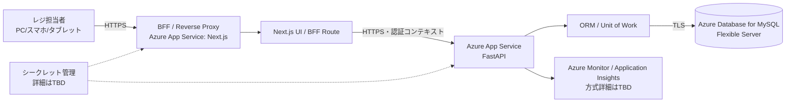
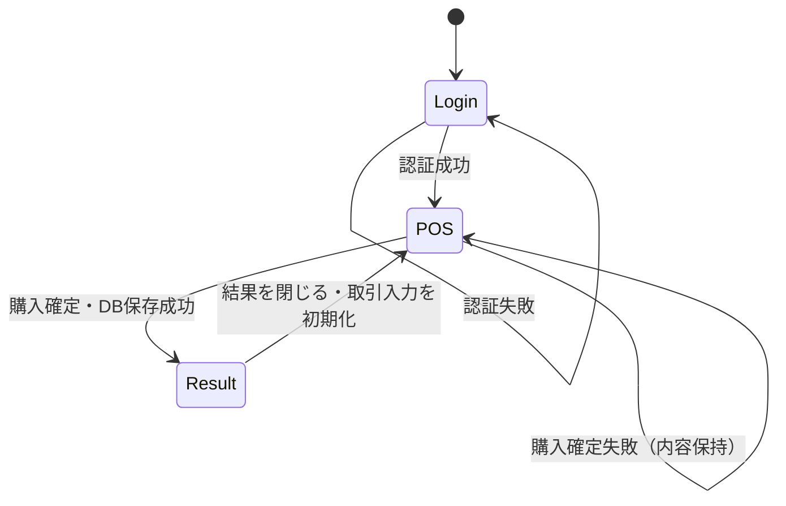
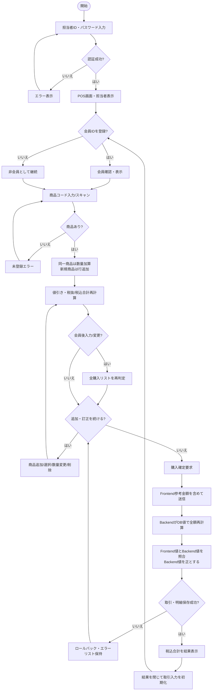
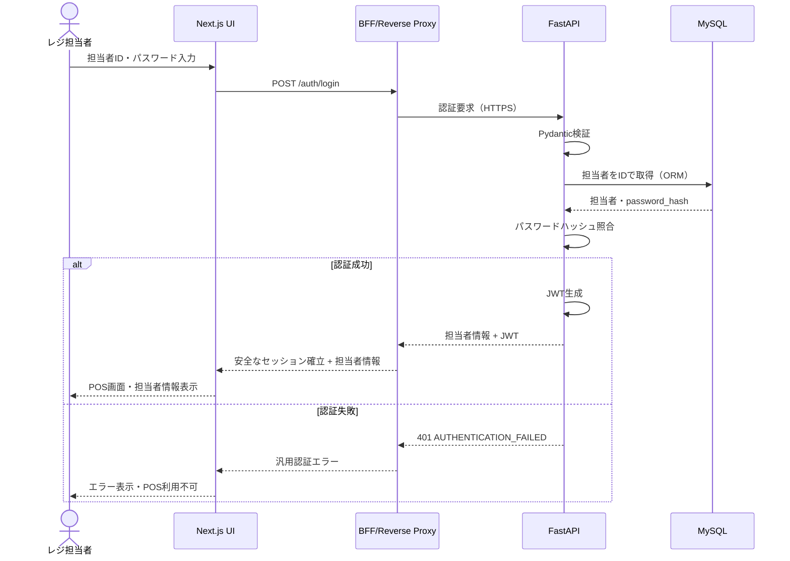
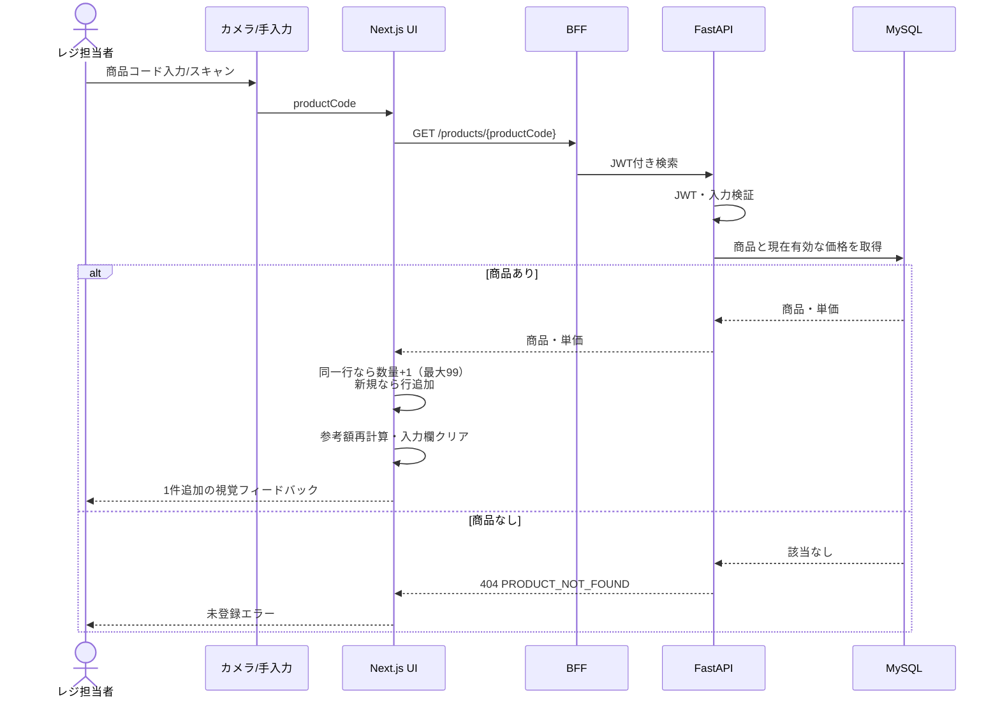
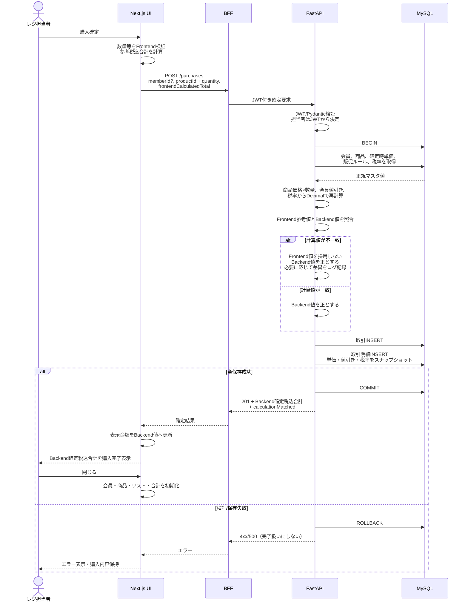
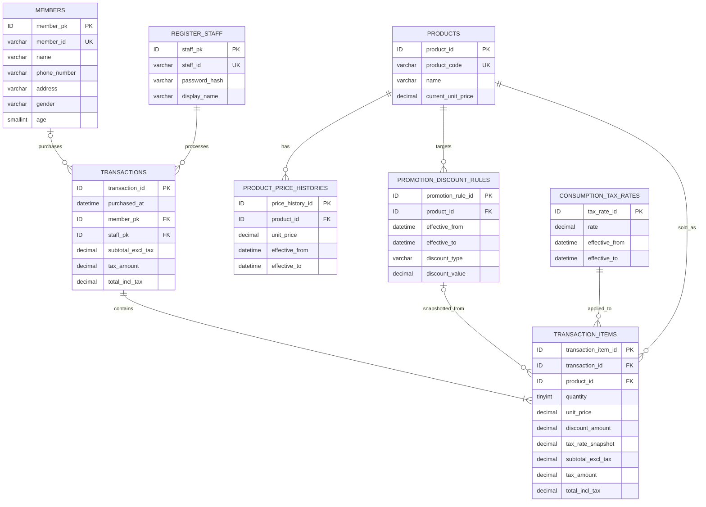

# Tech0 Lv2「簡易POSアプリ改」設計仕様書

## 0. 要件の識別

要件定義書の機能要件ID（FR-01〜FR-15）はそのまま使用する。非機能要件には原文上のIDがないため、追跡用に次の設計上のIDを付与する。これは要件の追加ではない。

| ID | 原文の区分 | 要約 |
|---|---|---|
| NFR-PERF-01 | 性能・可用性 | 営業時間中、検索・スキャン・購入を継続して同程度の応答速度で利用可能。ゼロから都度起動する構成を避け、DB接続をある程度維持する。目標値はTBD |
| NFR-DATA-01 | データ保全 | 取引、値引き、価格履歴等を永続化し、DB保存失敗を購入完了扱いにしない |
| NFR-SEC-01 | セキュリティ | 担当者認証、HTTPS、FrontendからDBへの直接接続禁止、秘密情報のFrontend非公開、Backend入力検証、パスワード非平文、購入確定時の整合性 |
| NFR-OPS-01 | 運用・保守 | 価格・税率・販促ルールをコード修正なしで変更可能、調査用エラー記録、確定取引のバックアップ・復旧。詳細方式はTBD |

## 1. 設計方針

1. **要件準拠優先**：FR-01〜FR-15と上記NFRだけを実現対象とし、返品、取消、レシート、在庫、決済連携、EC、SSO、複数店舗、セット割引、要件にない管理画面等は設計対象外とする。
2. **Backendを信頼境界とする**：Frontendの金額は即時表示ならびに改ざん検知・計算差異確認のための参考値に限定する。購入確定時は参考値もBackendへ送信するが、BackendはDBの有効な単価・会員・販促ルール・税率から全額を再計算してFrontend値と照合する。不一致でもFrontend値は採用せず、Backend計算値だけを保存・返却する。
3. **確定取引のスナップショット化**：取引・明細に販売時点の単価、値引き、税率、金額を保存し、マスタ変更後も確定済み実績を不変にする。
4. **原子性**：取引と全明細は単一DBトランザクションで保存する。一部でも失敗した場合は全件ロールバックし、完了表示を行わない。
5. **型と制約の多層防御**：TypeScript、Frontendフォーム検証、Pydantic、業務ロジック、ORM、DB制約を役割に応じて重ねる。Frontend検証の通過をBackendは信用しない。
6. **最小権限・経路限定**：ブラウザはBFF/Reverse Proxy経由でのみBackendへアクセスし、FrontendからDBへ接続しない。DBはBackendの管理ID/資格情報だけを許可する。
7. **決められないことを固定しない**：要件から一意に決まらない値・規格・運用方式は「TBD」とし、実装前判断事項に集約する。

### 1.1 金額の論理モデル

- 金額は浮動小数点数を使用せず、DBでは `DECIMAL`、Pythonでは `Decimal`、APIでは小数文字列を用いる。
- 明細の割引前金額：`販売時点単価 × 数量`
- 販促値引き：有効期間内かつ対象商品の会員向けルールを適用する。割合値引きと金額値引きに対応する。
- 明細税抜小計：`max(0, 割引前金額 - 値引き額)`
- 取引税抜合計：明細税抜小計の合計。
- 購入確定時、Frontendは上記ルールで算出した税込合計を `frontendCalculatedTotal` として送信する。Backendは正規の税込合計を再計算して10進数として照合し、差異の有無にかかわらずBackend計算値を購入金額とする。不一致時は画面をBackend値で更新し、必要に応じて差異を秘密情報・不要な個人情報を含めずログへ記録する。
- 税額および税込合計の端数処理、同一商品に複数ルールが該当した場合の優先・併用、金額値引きの単位（1個ごと/明細ごと）はTBDであり、決定後に共通計算仕様としてFrontend/Backendへ反映する。Backendの結果が常に正となる。

## 2. システムアーキテクチャ

### 2.1 論理・配置構成



| 層 | 責務 |
|---|---|
| Next.js UI | 画面表示、カメラ利用、手入力/スキャン受付、購入リストの一時状態、参考金額計算、入力時フィードバック |
| Next.js BFF / Reverse Proxy | 同一オリジンの入口、認証トークンの安全な保持・転送、Backend URLの隠蔽、共通ヘッダー、CORS境界 |
| FastAPI | JWT検証、認可、商品/会員検索、正規の価格・割引・税計算、購入確定、入力検証、エラー応答 |
| ORM | パラメータ化クエリ、エンティティ永続化、トランザクション境界、接続プール |
| MySQL Flexible Server | マスタ、履歴、担当者、取引、明細の永続化と制約 |
| Azure監視 | アプリケーション/監査に必要なエラー記録。サービス・保持期間はTBD |

### 2.2 可用性・性能方針

- 要件定義書のシステム構成には、Next.jsとFastAPIをAzure App Service上で稼働させる構成が記載されている。
- 本設計でも、営業時間中の安定した応答と、処理のたびに実行環境がゼロから立ち上がる構成を避けるという非機能要求に適合する実行基盤としてAzure App Serviceを採用する。常時稼働するWebアプリケーションを構成でき、DB接続プールを維持しやすいためである。
- ORMの接続プールを使用し、接続数、タイムアウト、App Serviceの常時稼働設定・最小インスタンス数は性能目標と同時利用数決定後に定める（TBD）。
- 商品/会員コード、適用期間検索、取引参照に必要なインデックスを設ける。
- 外部向け通信はHTTPSのみ。App Service、DB、監視、シークレット管理、バックアップのAzure詳細構成はTBD。

## 3. 画面・処理設計

### 3.1 画面遷移



### 3.2 ログイン画面 `SCR-LOGIN`

| 項目 | 設計 |
|---|---|
| 表示 | 担当者ID、パスワード、ログインボタン、認証失敗エラー |
| 入力 | 担当者ID（必須）、パスワード（必須） |
| 処理 | BFF経由でログインAPIを呼び、成功時にJWTを安全なセッション手段で保持してPOS画面へ遷移 |
| 失敗 | 入力不備は項目エラー。資格情報不一致は担当者ID/パスワードのどちらが違うかを開示しない |
| 対応 | FR-01、NFR-SEC-01 |

### 3.3 POSメイン画面 `SCR-POS`

| 領域 | 表示・操作 | 主処理 |
|---|---|---|
| 担当者 | ログイン中の担当者ID・表示名 | JWTの担当者とBackend取得結果を表示し、取引確定時はJWT主体を紐づける（クライアント指定不可） |
| 会員 | 会員ID入力/スキャン、会員識別情報 | 未入力は非会員。購入確定まで登録可能。登録後、購入リスト全体をBackend計算結果で再判定 |
| 商品入力 | 商品コード入力/スキャン、商品名、現在単価、追加操作 | 検索成功時に商品名・単価表示。追加後に入力・商品表示をクリア。同一商品は数量加算、新規は行追加 |
| スキャン | カメラ開始/停止、認識状態 | 認識成功ごとに1件追加の視覚フィードバック。連続読取時の重複抑制時間・対応規格/ライブラリはTBD |
| 購入リスト | 商品名、数量、単価、小計、値引き内容 | 1行選択、選択強調、選択商品の名称・単価・数量確認。数量1〜99、削除可能 |
| 合計 | 税抜合計、税込合計 | Frontendで参考再計算。会員/数量/商品変更時に更新。確定時はBackend再計算結果へ置換 |
| 確定 | 購入確定ボタン | Backendへ商品ID、数量、任意の会員ID、Frontend参考税込合計を送り、Backend照合・保存成功時だけ結果表示。画面金額はBackend値へ更新 |

購入リストが空の状態で確定できるかは要件に明記がない。データ整合性上は無効とする案が妥当だが、機能仕様としてはTBDとする。

### 3.4 購入結果表示 `DLG-RESULT`

| 項目 | 設計 |
|---|---|
| 表示 | Backendが確定・保存した税込合計 |
| 開く条件 | 購入確定APIが成功した場合のみ |
| 閉じる処理 | 会員、商品入力、商品表示、選択、購入リスト、合計をクリアし、次の会員ID登録開始状態へ戻す。ログイン担当者は維持 |
| 失敗時 | 表示しない。現在の購入内容を維持し、再確認できるエラーを表示 |
| 対応 | FR-12、NFR-DATA-01 |

### 3.5 主要処理ルール

1. 商品検索は商品コード完全一致とする。存在しなければ未登録エラーを表示する。
2. 商品追加時、同一商品行があれば数量を1加算する。ただし99を超える追加は拒否する。
3. 会員登録/変更/解除、数量変更、削除、商品追加のたびに購入リストの参考額を再計算する。会員ID後入力時は全行の値引きを再判定する。
4. 購入確定では商品ID、数量、会員ID（任意）に加え、Frontendの参考税込合計 `frontendCalculatedTotal` をRequestに含める。この値は改ざん検知・計算差異確認だけに使用し、購入金額の決定には使用しない。
5. Backendは確定時刻をサーバー時刻で固定し、その時点で有効な商品価格、会員、販促ルール、税率を同一トランザクションの整合した読み取りで取得する。
6. JWTの担当者、確認済み会員（任意）、商品・数量からBackendが金額を再計算し、Frontend参考値と照合する。不一致時はFrontend値を採用せず、必要に応じて差異をログへ記録し、ResponseのBackend値で画面を更新する。
7. 取引と明細へ保存する金額はBackend計算値だけとする。
8. 保存成功後にコミット済み金額をResponseで返す。保存失敗時はロールバックしエラーを返す。

## 4. API設計

### 4.1 共通仕様

- 公開経路：ブラウザ → Next.js BFF/Reverse Proxy → FastAPI。APIの例示パスはBFFから見た `/api/v1` とする。
- Content-Type：`application/json; charset=utf-8`。
- 認証：ログイン以外はJWT必須。JWTの署名、`exp`、`iss`、`aud`を検証する。トークン保持方式・有効期間・更新方式はTBD。
- 金額型：JSON numberの浮動小数誤差を避けるため、金額・率は正規化した10進文字列で返す（例 `"120.00"`）。通貨は要件から一意でないためTBD。
- 日時：ISO 8601、タイムゾーン付き。業務タイムゾーンはTBD。
- エラー形式：`{"error":{"code":"...","message":"...","fieldErrors":[{"field":"...","code":"..."}],"traceId":"..."}}`。内部例外・SQL・秘密情報は返さない。
- 冪等性：購入確定の二重送信防止方式（Idempotency-Key等）は要件にないがデータ整合性に影響するためTBD。決定なしに独自実装しない。

### 4.2 API一覧

| Method | Endpoint | Purpose | Request | 型 | 必須/任意 | バリデーション | Response | Error |
|---|---|---|---|---|---|---|---|---|
| POST | `/api/v1/auth/login` | 担当者ログイン | `staffId`, `password` | string, string | 両方必須 | 空白不可、長さ/文字種はTBD、認証照合 | `staff:{staffId,displayName}` と認証セッション/JWT | 400 `VALIDATION_ERROR`; 401 `AUTHENTICATION_FAILED`; 429方針はTBD; 500 |
| GET | `/api/v1/auth/me` | ログイン担当者表示・セッション確認 | なし（JWT） | - | JWT必須 | JWT検証、有効担当者 | `{staffId,displayName}` | 401 `UNAUTHORIZED`; 403 `STAFF_INACTIVE`（有効/無効管理採用はTBD）; 500 |
| GET | `/api/v1/members/{memberId}` | 会員確認・表示 | path `memberId` | string | 必須 | 空白不可、最大長64、許容文字 `[A-Za-z0-9_-]`（実コード体系はTBD） | `{memberId,name}`。画面表示する識別情報の範囲はTBD | 400; 401; 404の扱い自体がTBD; 500 |
| GET | `/api/v1/products/{productCode}` | 商品コード検索 | path `productCode` | string | 必須 | 空白不可、最大長64、許容文字 `[A-Za-z0-9_-]`（バーコード規格確定後見直し） | `{productId,productCode,name,currentUnitPrice,priceEffectiveAt}` | 400; 401; 404 `PRODUCT_NOT_FOUND`; 500 |
| POST | `/api/v1/purchases/quote` | 会員後入力・数量変更等の参考額をBackendルールで再評価 | `memberId?`, `items[]:{productId,quantity}` | string?, array(UUID/int,TBD + integer) | `memberId`任意、items必須 | items 1件以上とするかTBD、数量1〜99、重複商品は拒否または統合（TBD）、存在/有効性 | `{member?,items:[商品、数量、単価、値引き、税抜小計],subtotalExclTax,tax,totalInclTax}` | 400/401/404/409/422/500。存在しない会員の扱いはTBD |
| POST | `/api/v1/purchases` | Backend再計算、Frontend値との照合、購入確定・取引保存 | `memberId?`, `items[]:{productId,quantity}`, `frontendCalculatedTotal` | string?, array(ID + integer), decimal string | `memberId`任意、他は必須 | quote相当を再実施。数量1〜99。参考金額は0以上の10進文字列。JWT主体必須。Frontend値は決定・保存に使用しない | 201 `{transactionId,purchasedAt,subtotalExclTax,tax,totalInclTax,calculationMatched,items:[確定スナップショット]}`。金額はすべてBackend確定値 | 400; 401; 404; 409 `MASTER_DATA_CHANGED`等の採否TBD; 422; 500 `PURCHASE_SAVE_FAILED` |

`POST /purchases/quote` は、会員後入力時の全リスト再判定とBackendを正とする一貫した計算を画面で確認するための処理APIであり、永続化しない。Frontendでも同じ決定済みルールにより即時計算する。購入確定時の `frontendCalculatedTotal` は改ざん検知・実装上の計算差異確認のための参考値であり、BackendはDBの正規値による再計算結果と照合する。差異があればFrontend値を採用せず、必要に応じて差異をログに記録し、画面を確定ResponseのBackend値で上書きする。DBへ保存する金額はBackend計算値のみである。

### 4.3 Request / Response例

```json
// POST /api/v1/purchases
{
  "memberId": "M000123",
  "items": [
    { "productId": "018f3a20-0000-7000-8000-000000000001", "quantity": 2 }
  ],
  "frontendCalculatedTotal": "220.00"
}
```

```json
// 201 Created（例。通貨・端数規則はTBD）
{
  "transactionId": "018f3b10-0000-7000-8000-000000000001",
  "purchasedAt": "2026-09-05T13:00:00+09:00",
  "subtotalExclTax": "200.00",
  "tax": "20.00",
  "totalInclTax": "220.00",
  "calculationMatched": true,
  "items": [
    {
      "productId": "018f3a20-0000-7000-8000-000000000001",
      "productCode": "4900000000000",
      "productName": "商品A",
      "quantity": 2,
      "unitPrice": "120.00",
      "discountType": "AMOUNT",
      "discountValue": "20.00",
      "discountAmount": "40.00",
      "subtotalExclTax": "200.00",
      "taxRate": "0.100000",
      "taxAmount": "20.00"
    }
  ]
}
```

## 5. DB設計

### 5.1 共通方針

- DBはAzure Database for MySQL Flexible Server。文字コードは `utf8mb4`。
- ORMを利用し、SQLを文字列連結しない。生SQLが必要な場合もバインド変数を必須とする。
- 内部主キーの方式（BIGINT/UUID）はTBD。以下は論理型 `ID` と表記する。
- `created_at` / `updated_at` 等の監査列をマスタに設けるかは運用要件と合わせてTBD。取引の購入日時は必須。
- 物理削除・論理削除、有効/無効管理の方式は要件に明記がないためTBD。ただし確定済み取引・明細は更新/削除しない運用とする。

### 5.2 テーブル定義

#### `products` 商品

| 列 | 型 | NULL | 制約・用途 |
|---|---|---:|---|
| `product_id` | ID | NO | PK |
| `product_code` | VARCHAR(64) | NO | UNIQUE、検索キー。文字体系/バーコード規格はTBD |
| `name` | VARCHAR(255) | NO | 空文字不可 |
| `current_unit_price` | DECIMAL(13,2) | NO | `>= 0`。価格履歴との同期更新を同一トランザクションで行う |

#### `product_price_histories` 商品価格履歴

| 列 | 型 | NULL | 制約・用途 |
|---|---|---:|---|
| `price_history_id` | ID | NO | PK |
| `product_id` | ID | NO | FK → products |
| `unit_price` | DECIMAL(13,2) | NO | `>= 0` |
| `effective_from` | DATETIME(6) | NO | 適用開始（UTC保存を候補とするがTBD） |
| `effective_to` | DATETIME(6) | YES | 開区間 `[from,to)`、`to > from` |

同一商品で有効期間を重複させない。MySQL制約だけで表現しにくい場合は更新トランザクション内で排他・検証する。

#### `members` 会員

| 列 | 型 | NULL | 制約・用途 |
|---|---|---:|---|
| `member_pk` | ID | NO | PK |
| `member_id` | VARCHAR(64) | NO | UNIQUE、外部入力ID。コード体系はTBD |
| `name` | VARCHAR(255) | NO | 表示用 |
| `phone_number` | VARCHAR(32) | YES | 数値型にしない。書式・必須性TBD |
| `address` | VARCHAR(500) | YES | 必須性TBD |
| `gender` | VARCHAR(32) | YES | 値体系TBD |
| `age` | SMALLINT UNSIGNED | YES | `0〜150`を暫定DB境界とするか、生年月日保持かを含めTBD |

要件書は会員が登録済みであることのみを前提とし、会員登録/編集API・画面は本設計に含めない。

#### `register_staff` レジ担当者

| 列 | 型 | NULL | 制約・用途 |
|---|---|---:|---|
| `staff_pk` | ID | NO | PK |
| `staff_id` | VARCHAR(64) | NO | UNIQUE、ログイン入力。コード体系TBD |
| `password_hash` | VARCHAR(255) | NO | Argon2id/bcrypt等。アルゴリズム・パラメータTBD。平文禁止 |
| `display_name` | VARCHAR(255) | NO | POS画面表示 |

#### `promotion_discount_rules` 販促値引きルール

| 列 | 型 | NULL | 制約・用途 |
|---|---|---:|---|
| `promotion_rule_id` | ID | NO | PK |
| `product_id` | ID | NO | FK → products |
| `effective_from` | DATETIME(6) | NO | 適用開始 |
| `effective_to` | DATETIME(6) | YES | 適用終了、`to > from` |
| `discount_type` | ENUM相当 | NO | `PERCENT` / `AMOUNT` |
| `discount_value` | DECIMAL(13,6) | NO | `> 0`。PERCENTの表現（0〜1/0〜100）と上限はTBD |

ルールの会員限定は本システムの販促値引き自体の前提として処理層で保証する。複数ルールの重複可否・優先順位・併用はTBD。

#### `consumption_tax_rates` 消費税率

| 列 | 型 | NULL | 制約・用途 |
|---|---|---:|---|
| `tax_rate_id` | ID | NO | PK |
| `rate` | DECIMAL(7,6) | NO | `0 <= rate <= 1` |
| `effective_from` | DATETIME(6) | NO | 適用開始 |
| `effective_to` | DATETIME(6) | YES | 適用終了、`to > from` |

要件は税区分/商品別税率を定義していない。税率の選択単位と複数税率の扱いはTBD。適用期間の重複は許可しない方針候補とする。

#### `transactions` 取引

| 列 | 型 | NULL | 制約・用途 |
|---|---|---:|---|
| `transaction_id` | ID | NO | PK |
| `purchased_at` | DATETIME(6) | NO | Backend確定日時、INDEX |
| `member_pk` | ID | YES | FK → members。非会員はNULL |
| `member_id_snapshot` | VARCHAR(64) | YES | 販売時の会員ID |
| `member_name_snapshot` | VARCHAR(255) | YES | 「誰が買い」の後日確認用。保持範囲は個人情報方針と合わせTBD |
| `staff_pk` | ID | NO | FK → register_staff |
| `staff_id_snapshot` | VARCHAR(64) | NO | 販売時の担当者ID |
| `staff_name_snapshot` | VARCHAR(255) | NO | 販売時の表示名 |
| `subtotal_excl_tax` | DECIMAL(15,2) | NO | `>= 0`、確定値 |
| `tax_amount` | DECIMAL(15,2) | NO | `>= 0`、確定値 |
| `total_incl_tax` | DECIMAL(15,2) | NO | `>= 0`、確定値 |

#### `transaction_items` 取引明細

| 列 | 型 | NULL | 制約・用途 |
|---|---|---:|---|
| `transaction_item_id` | ID | NO | PK |
| `transaction_id` | ID | NO | FK → transactions、INDEX |
| `line_number` | SMALLINT UNSIGNED | NO | 取引内UNIQUE、`>= 1` |
| `product_id` | ID | NO | FK → products |
| `product_code_snapshot` | VARCHAR(64) | NO | 販売時商品コード |
| `product_name_snapshot` | VARCHAR(255) | NO | 販売時商品名 |
| `quantity` | TINYINT UNSIGNED | NO | CHECK `1 <= quantity AND quantity <= 99` |
| `unit_price` | DECIMAL(13,2) | NO | `>= 0`、販売時点単価 |
| `promotion_rule_id` | ID | YES | FK → promotion_discount_rules |
| `discount_type_snapshot` | VARCHAR(16) | YES | `PERCENT` / `AMOUNT` |
| `discount_value_snapshot` | DECIMAL(13,6) | YES | 適用時ルール値 |
| `discount_amount` | DECIMAL(15,2) | NO | `>= 0`、実適用額 |
| `tax_rate_id` | ID | NO | FK → consumption_tax_rates |
| `tax_rate_snapshot` | DECIMAL(7,6) | NO | 販売時税率 |
| `subtotal_excl_tax` | DECIMAL(15,2) | NO | 値引き後税抜小計 |
| `tax_amount` | DECIMAL(15,2) | NO | 明細税額 |
| `total_incl_tax` | DECIMAL(15,2) | NO | 明細税込小計 |

### 5.3 購入確定トランザクション

1. JWTから担当者を特定し、認証状態を再確認する。
2. 会員IDがあれば会員を検索する。存在しない場合の扱いはTBD決定に従う。
3. サーバー確定日時を取得する。
4. 全商品、確定日時に有効な価格、販促ルール、税率をDBから取得する。
5. 数量とルールを検証し、`Decimal`で単価・値引き・税額・合計を再計算する。
6. Backend計算値と `frontendCalculatedTotal` を照合する。不一致でもFrontend値は採用せず、Backend値を正とし、必要に応じて差異をログへ記録する。
7. Backend計算値だけを用いて`transactions`をINSERTし、全`transaction_items`をスナップショット付きでINSERTする。
8. 合計整合性を検証し、単一トランザクションをコミットする。
9. コミット成功後のみBackend確定値と照合結果を含む201を返す。例外時はロールバックし、購入結果を表示させない。

## 6. UML

### 6.1 アクティビティ図（販売業務）



### 6.2 シーケンス図（ログイン）



### 6.3 シーケンス図（商品登録）



### 6.4 シーケンス図（購入確定）



### 6.5 ER図



## 7. セキュリティ設計

| 領域 | 設計 | 目的／防ぐリスク |
|---|---|---|
| JWTログイン | 担当者ID/パスワード照合後に短寿命・署名付きJWTを発行。`sub`は内部担当者識別子、`iss`/`aud`/`iat`/`exp`を持たせ、全保護APIで署名とClaimsを検証。署名アルゴリズム、鍵管理、期限、更新/失効方式はTBD | 未認証利用、トークン偽造、不正なAPI利用を防ぐ |
| パスワード | 平文・復号可能暗号で保存せず、ソルト付きArgon2idまたはbcrypt等の承認済み方式でハッシュ化。具体方式とパラメータTBD。ログ・Responseに出さない | DBやログ流出時のパスワード露出・再利用リスクを下げる |
| 認証・認可 | ログイン以外はJWT必須。現要件の利用者はレジ担当者のみで、ロール別権限は未定義。取引の担当者はRequest値ではなくJWT主体から決定。マスタ変更経路・権限はTBD | 他者へのなりすまし、未認証操作、権限外処理を防ぐ |
| BFF / Reverse Proxy | ブラウザからの入口をNext.js同一オリジンへ集約し、FastAPI/DBを直接公開しない。JWTをJavaScriptから読める保存域に置くことを避ける候補設計とし、保存方式はTBD | Backendの直接公開を減らし、ブラウザとの通信経路と認証情報の取扱いを制御する |
| CORS | ブラウザからFastAPIへの直接クロスオリジン呼出しを前提にしない。必要時も許可Originを本番Frontendの固定オリジンに限定し、`*`と資格情報の併用を禁止。Method/Headerも必要最小限 | 想定外Originからのブラウザアクセスを制限する |
| HTTPS | ブラウザ〜BFF〜Backend、Backend〜DBの通信を暗号化。HTTPはHTTPSへリダイレクトし、Secure Cookieを使用 | 通信内容・認証情報の盗聴や通信経路上の改ざんを防ぐ |
| Backend金額再計算 | 商品ID・数量・会員IDを基に、DBの有効な単価・販促ルール・税率からBackendで必ず再計算し、Backend値だけを保存する | Frontend改ざんによる購入金額操作を防ぐ |
| Frontend / Backend計算値照合 | Requestの `frontendCalculatedTotal` とBackend再計算値を照合する。不一致でもFrontend値は採用せず、Backend値で画面を更新し、必要に応じ差異をログへ記録する | 実装差異、改ざん、丸め処理等による計算不一致を検知する |
| Swagger Docs | FastAPIの `/docs`、`/redoc`、`/openapi.json` は本番で非公開/無効化。開発環境のみ必要に応じ有効化 | API仕様・操作方法の不要な外部公開を防ぐ |
| SQL Injection | SQLAlchemy等のORMとパラメータバインドを利用。文字列連結SQLは禁止。DBユーザーは必要なschema操作権限のみに限定 | SQL Injectionと侵害時のDB影響範囲拡大を防ぐ |
| 入力検証 | FrontendはTypeScriptとフォームスキーマ、BackendはPydantic strict制約、DBは型・UNIQUE・FK・CHECKで検証。文字列長、文字種、配列件数、数量1〜99をBackendでも検証 | 不正値・型不一致・想定外データによる処理異常や不正処理を防ぐ |
| 秘密情報・個人情報・ログ | DB資格情報・JWT鍵をFrontend bundle、リポジトリ、ログへ含めない。ログはtraceIdで関連付け、パスワード、JWT、秘密、不要な会員情報を記録しない。Azureでの秘密保管方式等はTBD | 秘密情報・個人情報の漏えいと、障害調査時の過剰なデータ露出を防ぐ |
| OSS脆弱性確認 | Next.js、Node.js、TypeScript、FastAPI、Python、Pydantic、ORM、JWT/パスワード/バーコードライブラリ等はサポート中の固定Versionを選定しlockfileを保持。導入時・CI・定期運用でCVE/依存脆弱性を確認する。Versionと確認方式は実装詳細で決定 | 既知脆弱性を含むFramework / Library利用リスクを下げる |

## 8. エラー・バリデーション設計

### 8.1 入力制約

| 対象 | Frontend | Backend / DB | エラー時 |
|---|---|---|---|
| 担当者ID | 必須、前後空白処理方針TBD、最大64 | Pydantic最大64、許容文字体系TBD、UNIQUE | 項目エラー/認証失敗 |
| パスワード | 必須、マスク表示 | 空不可、最大長とポリシーTBD。平文非保存 | 汎用認証失敗 |
| 会員ID | 任意、最大64 | 最大64、暫定許容文字 `[A-Za-z0-9_-]`。実体系TBD | 存在しないIDの扱いTBD |
| 商品コード | 必須、最大64 | 最大64、バーコード規格に応じた文字種TBD、UNIQUE | `PRODUCT_NOT_FOUND` |
| 数量 | 整数、1〜99、0不可 | strict integer、1〜99、DB CHECK | 422、行と理由を表示 |
| 購入明細 | 配列 | 最大件数TBD。空リスト可否、重複ID処理TBD | 400/422 |
| Frontend参考金額 | Decimal相当ロジックで算出し、`frontendCalculatedTotal` を0以上の10進文字列で送信 | Pydanticで形式検証後、DB値からPython `Decimal`で算出したBackend値と照合。決定・保存には不使用 | 不一致でも確定処理を継続し、Backend値で表示更新。必要に応じ差異ログ |
| Backend確定金額 | Backend Responseで表示を上書き | DBの正規値から計算し、DECIMALで保存する唯一の正規金額 | 保存失敗は未完了。Frontend参考値へのフォールバック禁止 |
| 適用期間 | UIなし（マスタ管理は対象外） | `effective_to > effective_from`、重複禁止方針 | マスタ更新側で拒否（経路TBD） |

### 8.2 エラー分類

| HTTP | code例 | 条件 | 画面動作 |
|---:|---|---|---|
| 400 | `VALIDATION_ERROR` | JSON形式、path/queryの基本不正 | 該当項目を示し、入力状態保持 |
| 401 | `AUTHENTICATION_FAILED`, `UNAUTHORIZED` | ログイン失敗/JWT無効・期限切れ | ログイン失敗表示、またはログイン画面へ。再ログイン時のカート保持はTBD |
| 403 | `FORBIDDEN` | 認証済みだが権限なし（権限体系TBD） | 操作不可を表示 |
| 404 | `PRODUCT_NOT_FOUND` | 商品なし | 未登録商品である旨を表示 |
| 404等 | `MEMBER_NOT_FOUND` | 会員なし | HTTP/画面挙動ともTBD |
| 409 | `MASTER_DATA_CHANGED` | 表示後〜確定間に価格/ルール等変更を検出する方式を採る場合 | Backend再計算結果で再確認。方式採否TBD |
| 422 | `QUANTITY_OUT_OF_RANGE` | 数量が整数でない、1〜99外 | 対象行を示し確定しない |
| 422 | `INVALID_FRONTEND_TOTAL` | Frontend参考金額が10進文字列でない、または負数 | 入力異常として確定せず、購入内容を保持 |
| 500 | `PURCHASE_SAVE_FAILED` | DB/予期せぬエラー | 完了表示せず、カート保持。traceIdを表示可能にする |
| 503 | `SERVICE_UNAVAILABLE` | Backend/DB一時利用不可 | 完了扱いにせず再試行案内。自動再送は二重登録対策決定後 |

Frontend値とBackend値の金額差異自体は購入失敗としない。Frontend値は採用せず、Backend値を画面へ返して表示を更新する。差異ログを記録する場合は、Frontend値、Backend値、traceId、必要最小限の識別情報を対象とし、秘密情報・不要な個人情報は含めない。Backend内部エラーはスタックトレースやSQLを利用者へ返さず、ログにtraceIdで関連づける。購入確定のタイムアウト時の扱いは実装詳細で決定する。

## 9. 要件との対応表

### 9.1 機能要件

| 要件ID | 画面 | API | DB | 処理・設計箇所 |
|---|---|---|---|---|
| FR-01 | SCR-LOGIN | POST `/auth/login` | register_staff | パスワードハッシュ照合、失敗時POS不可（3.2, 6.2, 7） |
| FR-02 | SCR-POS担当者領域 | GET `/auth/me`; POST `/purchases` | register_staff, transactions | JWT主体を表示・確定取引に紐付け（3.3, 5.3） |
| FR-03 | SCR-POS会員領域 | GET `/members/{memberId}`; POST `/purchases/quote`; POST `/purchases` | members, transactions | 手入力/スキャン、任意タイミング、未入力はNULL（3.3, 3.5） |
| FR-04 | SCR-POS会員領域 | GET `/members/{memberId}` | members | IDと識別情報表示。表示範囲TBD（3.3, 4.2） |
| FR-05 | SCR-POS商品入力 | GET `/products/{productCode}` | products, product_price_histories | 商品名・有効単価表示、404未登録表示（3.5, 6.3） |
| FR-06 | SCR-POS商品入力/リスト | GET `/products/{productCode}` | products | 同一商品数量加算、新規行、追加後入力クリア（3.3, 3.5） |
| FR-07 | SCR-POSスキャン | 商品検索API | products | カメラ連続読取、成功フィードバック。規格/ライブラリTBD（3.3） |
| FR-08 | SCR-POS購入リスト | quote | products, promotion rules | 項目一覧、単一選択・強調、選択商品確認（3.3） |
| FR-09 | SCR-POS購入リスト | quote; purchases | transaction_items | 削除、数量1〜99、0拒否、再計算（3.3, 8.1） |
| FR-10 | SCR-POS会員/リスト | quote; purchases | members, promotion_discount_rules, transaction_items | 会員限定、対象/期間/率・額、値引き表示、後入力全行再判定（1.1, 3.5, 5.3） |
| FR-11 | SCR-POS合計 | quote; purchases | transactions | Frontend参考額をBackend再計算値と照合し、Backend値で税抜・税込合計を確定・表示（1.1, 3.3, 4.2） |
| FR-12 | SCR-POS; DLG-RESULT | POST `/purchases` | transactions, transaction_items | 照合後、Backend金額のみを原子保存。成功時Backend税込結果を表示し、閉じて次取引初期化（3.4, 5.3, 6.4） |
| FR-13 | 結果表示（後日確認UIは要件なし） | purchases（参照APIは要件なし） | transactions, transaction_items | 日時、商品、数量、販売時単価、会員、担当者の保持（5.2） |
| FR-14 | 対象画面なし（管理画面は要件外） | 管理APIは要件なし/TBD | product_price_histories, promotion_discount_rules, consumption_tax_rates | コードでなくデータとして管理。ただし変更手段・権限はTBD（5.2） |
| FR-15 | 画面なし | purchases | transactions, transaction_items | 単価・値引き・税率・金額スナップショット（1, 5.2） |

### 9.2 非機能要件

| 要件ID | 画面 | API/構成 | DB | 処理・設計箇所 |
|---|---|---|---|---|
| NFR-PERF-01 | 全画面 | App Service常駐構成、BFF/FastAPI | 接続プール、検索INDEX | 2.1, 2.2。数値目標・同時利用数はTBD |
| NFR-DATA-01 | 成功時のみ結果表示、失敗時リスト保持 | purchases | 単一トランザクション、永続化、スナップショット | 3.4, 5.3, 8.2 |
| NFR-SEC-01 | ログイン/全入力・Backend値で金額更新 | HTTPS、JWT、BFF、Backend再計算・Frontend値照合、Swagger非公開 | ORM、最小権限、password_hash、Backend値のみ保存、制約 | 3.5, 4.2, 5.3, 6.4, 7, 8 |
| NFR-OPS-01 | 管理UIは未要求 | ログ/監視、マスタ変更経路TBD | データ駆動マスタ、バックアップ/復旧TBD | 2.2, 5, 7 |

## 10. TBD・実装前確認事項

### 10.1 この設計で要件を満たせていない箇所

現時点で意図的に未確定のため、実装可能な詳細まで満たせていない箇所は次のとおりである。

1. FR-03：存在しない会員IDの具体的な扱いが未定。
2. FR-07：対応バーコード規格、読取ライブラリ、連続読取時の重複抑制が未定。
3. FR-10/FR-11/BR-06：複数値引きの優先・併用、消費税の端数処理が未定で、金額計算を完全に一意化できない。
4. FR-14：税率・販促・価格をデータ化したが、それを誰がどの経路で変更するかが未定。要件に管理画面/APIの要求はないため勝手に追加していない。
5. NFR-PERF-01：性能、同時利用数、可用性の数値目標が未定で、サイジング/タイムアウト/スケール設定を確定できない。
6. NFR-OPS-01：バックアップ、保持期間、復旧、監視、シークレット管理、Azureネットワークの詳細が未定。
7. JWT採用方針は示したが、認証セッション保持・失効・更新の詳細が未定。
8. FR-13はDBで後から確認可能な情報を保持するが、取引履歴を閲覧する画面/APIは要件にないため設計していない。

### 10.2 実装前に人間が判断すべき主要TBD

次の6項目は業務結果、セキュリティまたは非機能設計に直接影響するため、実装開始前に人間が合意し、本書へ反映する。

1. **消費税の端数処理**：切上げ・切捨て・四捨五入のいずれか、および明細単位か取引単位か。
2. **複数の会員向け値引きが成立した場合の優先順位・併用**：単一ルール採用か併用か、採用順序。
3. **存在しない会員IDの扱い**：再入力、非会員として継続、購入確定禁止のいずれとするか。
4. **バーコード規格・読み取りライブラリ**：対象規格、対応端末/ブラウザ、利用ライブラリ。
5. **JWTの保存方式・有効期限・更新／失効**：BFF/Cookie等の保持方式、期限、更新、ログアウトを含む失効方式。
6. **性能目標・同時利用数・Azure詳細設定**：応答時間、同時利用数、可用性目標を決め、App Service/DBの常時稼働、接続プール、サイジング、ネットワーク等を確定する。

### 10.3 実装詳細で決定する事項

次の事項も削除せずTBDとして維持するが、上記6項目に比べて提出時の重要度を下げ、実装設計・運用設計の段階で決定する。

| 分類 | 実装詳細で決定する事項 |
|---|---|
| ID・データモデル | 内部PK方式、監査列、論理削除/有効状態、性別値体系、年齢/生年月日の保持方式、正式なID文字種・長さ |
| 金額詳細 | 通貨、小数桁、税率の選択単位、金額値引きの適用単位・上限、割合値の表現 |
| 商品・購入 | 空リスト確定可否、明細最大件数、重複商品のAPI処理、表示後にマスタが変わった場合の扱い |
| API・障害 | 429応答方針、`MASTER_DATA_CHANGED`の採否、Idempotency-Key等の二重送信対策、タイムアウト時のコミット確認・再送 |
| 日時 | 業務タイムゾーン、日時のDB保存方式 |
| 会員・担当者 | 会員表示範囲、解除/差替え操作、個人情報保持・マスキング、担当者/会員マスタ変更時の扱い |
| スキャン詳細 | カメラ許可拒否時の動作、連続読取の重複抑制 |
| 認証詳細 | JWT署名方式・鍵、ログイン試行制限、パスワードポリシー・ハッシュ方式 |
| マスタ運用 | 価格・税率・販促ルールの変更手段・認可・監査、適用期間重複の扱い。管理画面は追加しない |
| 運用・データ保護 | ログ/監視/アラート、秘密保管・ローテーション、バックアップ方式・頻度・保持期間・RPO/RTO・復旧手順 |
| OSS | 各Framework/Libraryの固定Version、SCA/CVE確認ツール・頻度、更新方針 |

### 10.4 最終確認

| 確認項目 | 結果 | 反映箇所 |
|---|---|---|
| JWT | 反映済み | 4.1, 6.2, 7 |
| 認証・認可 | 反映済み | 3.2, 4.2, 7 |
| BFF / Reverse Proxy | 反映済み | 2.1, 4.1, 7 |
| CORS | 反映済み | 2.1, 7 |
| Frontend / Backend計算値照合 | 反映済み | 1.1, 3.5, 4.2, 5.3, 6.1, 6.4, 7, 8 |
| Swagger Docs非表示 | 反映済み | 7 |
| SQL Injection対策 | 反映済み | 2.1, 5.1, 7 |
| TypeScript等の型定義 | 反映済み | 1, 4, 7, 8.1 |
| ORM | 反映済み | 2.1, 5.1, 7 |
| OSS / Framework脆弱性確認 | 反映済み | 7, 10.3 |
| 入力値・商品数量の上下限 | 反映済み | 4.2, 5.2, 8.1 |
| エラー処理 | 反映済み | 3.4, 4.1, 8.2 |
| API一覧、入力／出力／型 | 反映済み | 4.2, 4.3 |
| ER図 | 反映済み（追加なし） | 6.5 |
| アクティビティ図 | 反映済み（追加なし） | 6.1 |
| シーケンス図 | 反映済み（ログイン、商品登録、購入確定。追加なし） | 6.2〜6.4 |

要件定義書との照合結果、FR-01〜FR-15およびNFRの対象範囲に不整合はない。今回の変更は購入金額の決定機能を増やすものではなく、Frontend参考値を照合に利用しつつBackend計算値を唯一の正規値として保存するセキュリティ設計の具体化である。Azure App Serviceの採用は、要件定義書のシステム構成の記載および非機能要求と整合している。在庫、返品、取消、レシート、決済連携、EC、複数店舗、管理画面、セット割引等は追加していない。
